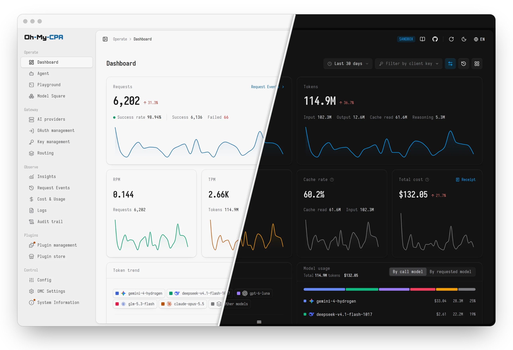
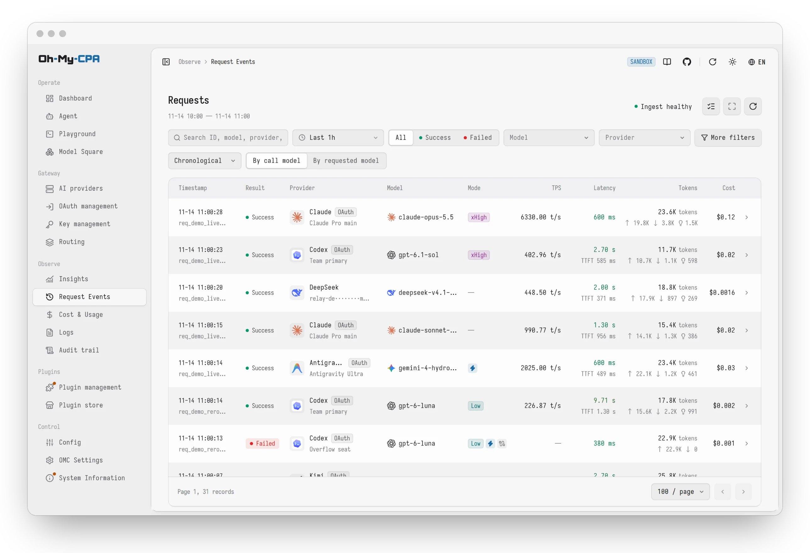
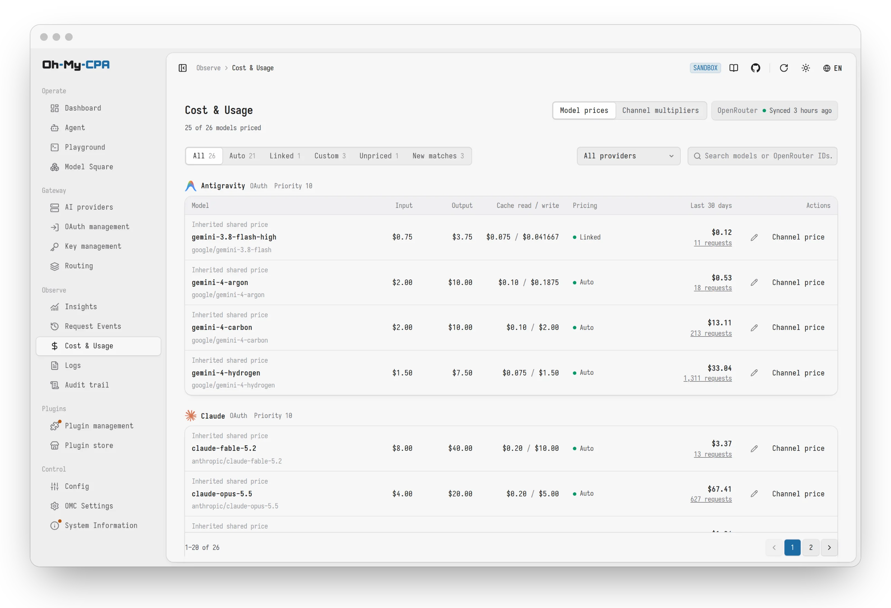
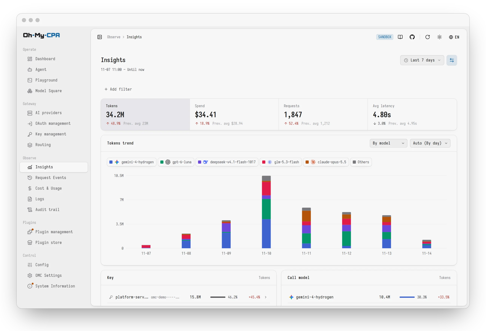
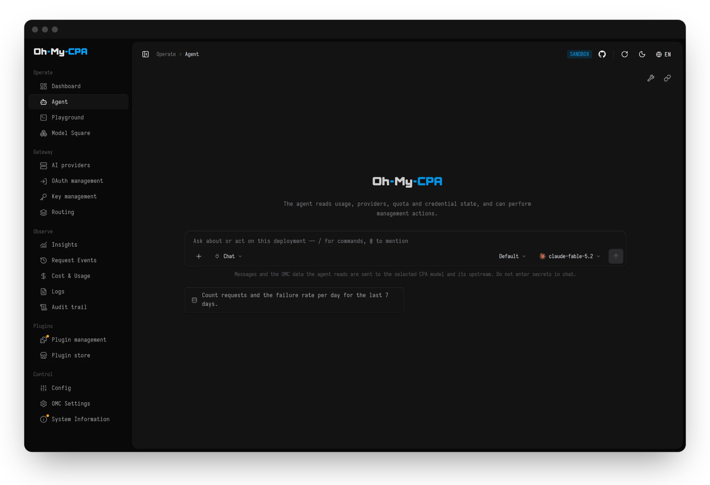
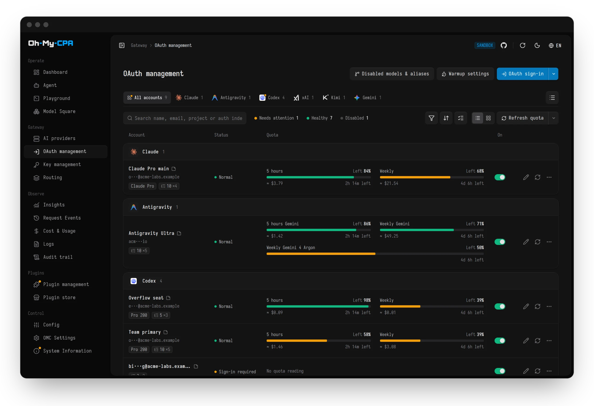
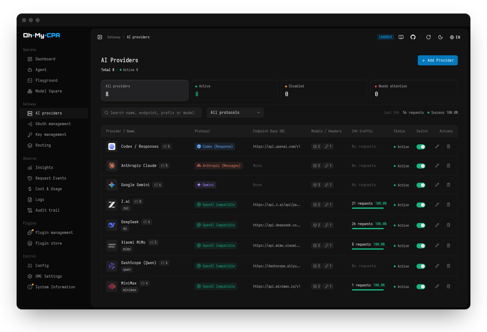
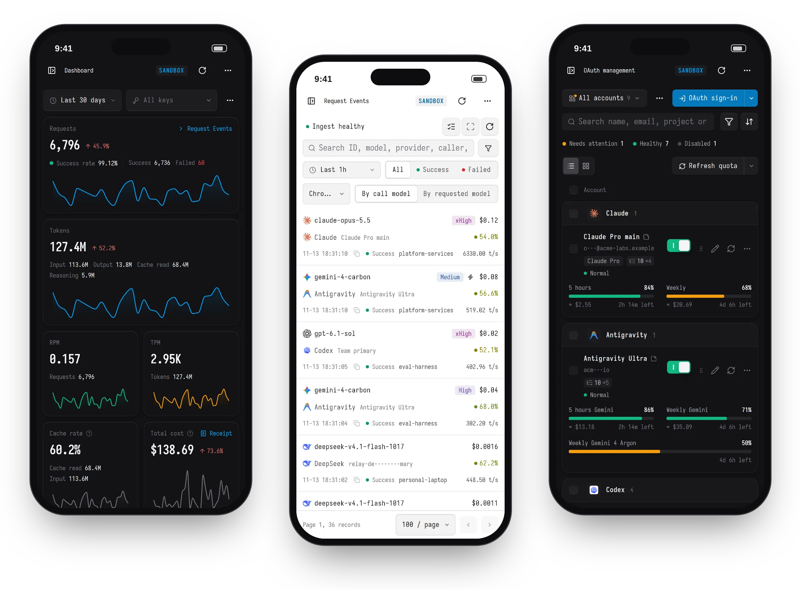

<div align="center">

<a href="#gh-light-mode-only">
  
</a>
<a href="#gh-dark-mode-only">
  
</a>

### Manage APIs and OAuth in one place, visualize requests, cost and usage

MCP · Visualization · Management

<br />

[](https://github.com/WizisCool/oh-my-cpa/releases)
[](https://github.com/WizisCool/oh-my-cpa/actions/workflows/ci.yml)
[](https://github.com/WizisCool/oh-my-cpa/stargazers)
[](https://hub.docker.com/r/wiziscool/oh-my-cpa)
[](https://github.com/router-for-me/CLIProxyAPI)
[](LICENSE)

<br />

**[Live Demo](https://omc-demo.junze.dev)** ·
[Install](#install) ·
[Features](#features) ·
[Ecosystem & Plugins](#ecosystem--plugins) ·
[Documentation](#documentation) ·
[简体中文](README.zh-CN.md)

<br />

<a href="https://omc-demo.junze.dev">
  
</a>

</div>

[CLIProxyAPI](https://github.com/router-for-me/CLIProxyAPI) (CPA) is an API gateway: it
adapts protocols, holds credentials and proxies requests. **Oh My CPA** (OMC) is a web
console for it. OMC manages the gateway's providers, credentials and configuration, and
records the usage and cost of every request. It is a single Go
binary with the React console embedded and a local SQLite database, runs offline, and
signs in with CPA's management key.

> [!TIP]
> **[Try the Live Demo](https://omc-demo.junze.dev)**

## Screenshots

<table>
<tr>
<td width="50%" valign="top">

<p align="center"><b>Request records</b><br />Every request, filterable by model, provider, key, status and cost</p>
</td>
<td width="50%" valign="top">

<p align="center"><b>Cost &amp; usage</b><br />A price book matched from OpenRouter, with custom overrides</p>
</td>
</tr>
<tr>
<td width="50%" valign="top">

<p align="center"><b>Insights</b><br />Compare usage across keys, models and providers with trends and rhythms</p>
</td>
<td width="50%" valign="top">

<p align="center"><b>Agent</b><br />Query usage, analyze traffic and operate the console in natural language</p>
</td>
</tr>
<tr>
<td width="50%" valign="top">

<p align="center"><b>OAuth management</b><br />Sign in, inspect quota and configure each credential in one place</p>
</td>
<td width="50%" valign="top">

<p align="center"><b>AI providers</b><br />Endpoints, models, priority and an enable switch enforced by the gateway</p>
</td>
</tr>
</table>

<div align="center">
  
  <p><b>Mobile layout</b><br />Every page adapts to a narrow screen</p>
</div>

## Install

### Install with an agent

Paste the following into Claude Code, Codex, Cursor or another coding agent. The agent
inspects the machine, picks the matching method and installs it:

```text
Install Oh My CPA for me by following
https://raw.githubusercontent.com/WizisCool/oh-my-cpa/main/docs/install-for-agents.md
```

### Install with Docker Compose

Requires Docker Engine with the Compose plugin and CLIProxyAPI v8.0.0 or later. The
commands assume a Linux or macOS shell with `curl` and `openssl`. The console's sign-in
password is CPA's management key.

| Scenario | Method |
| --- | --- |
| CPA is not deployed yet | [New install](#new-install) |
| CPA is already deployed | [CLIProxyAPI is already installed](#cliproxyapi-is-already-installed) |

#### New install

Deploys CPA, OMC and the console updater together in a new directory:

```bash
mkdir -p oh-my-cpa && cd oh-my-cpa
curl -fsSL https://github.com/WizisCool/oh-my-cpa/releases/latest/download/compose.full.yml -o compose.yml
curl -fsSL https://github.com/WizisCool/oh-my-cpa/releases/latest/download/cpa.config.example.yaml -o config.yaml
printf 'CPA_MANAGEMENT_KEY=%s\nOMCPA_MASTER_KEY=%s\n' "$(openssl rand -hex 24)" "$(openssl rand -hex 32)" > .env
chmod 600 .env
docker compose up -d
```

Open **`http://127.0.0.1:8080/`** and sign in with the `CPA_MANAGEMENT_KEY` value
from `.env`. Providers and client keys are added in the console; clients send requests
to CPA at `http://127.0.0.1:8317`.

#### CLIProxyAPI is already installed

Deploys OMC and the updater beside an existing CPA without modifying or restarting CPA:

```bash
mkdir -p oh-my-cpa && cd oh-my-cpa
curl -fsSL https://github.com/WizisCool/oh-my-cpa/releases/latest/download/compose.omc.yml -o compose.yml
printf 'OMCPA_CPA_BASE_URL=http://host.docker.internal:8317\nOMCPA_MASTER_KEY=%s\n' "$(openssl rand -hex 32)" > .env
cat >> .env <<'EOF'
OMCPA_CPA_MANAGEMENT_KEY='<CPA plaintext management key, not the hash in config.yaml>'
EOF
chmod 600 .env
```

Edit `.env` to replace `<CPA plaintext management key, not the hash in config.yaml>` (keep single quotes if the key contains `$`, escaping any literal `'` as `\'`), set `OMCPA_CPA_BASE_URL` for where CPA runs, and start:

```bash
docker compose up -d
```

| Where CPA runs | `.env` setting |
| --- | --- |
| Same host, listening on all interfaces | `OMCPA_CPA_BASE_URL=http://host.docker.internal:8317` (default above) |
| Another Docker Compose project | `OMCPA_CPA_BASE_URL=http://<CPA service or container>:8317`, plus `OMCPA_NETWORK_NAME=<CPA network>` and `OMCPA_NETWORK_EXTERNAL=true` (or [add to CPA's Compose file](docs/install.md#add-to-the-existing-compose-file)) |
| Another machine | `OMCPA_CPA_BASE_URL=https://<CPA host>:8317` (or its private network URL) |
| Same host, `127.0.0.1` only | Use the [native executable](#install-a-native-executable) |

Open **`http://127.0.0.1:8080/`** and sign in with the management key.

Common `.env` adjustments (no `compose.yml` edits needed; run `docker compose up -d` to apply):

| Need | `.env` setting |
| --- | --- |
| Port `8080` is already in use | `OMCPA_BIND=127.0.0.1:18317` (changes only the host port; keep container port `8080`) |
| Store data in `./oh-my-cpa-data` | `OMCPA_DATA_PATH=./oh-my-cpa-data` and `OMCPA_USER=<host uid:gid>` (for example `1000:1000`, after `mkdir -p -m 700 ./oh-my-cpa-data`; set before first start, as changing `OMCPA_DATA_PATH` later opens a new empty directory without moving existing volume data—see [SQLite operations](docs/ops/sqlite-operations.md)) |
| Serve behind an HTTPS reverse proxy | Proxy to `127.0.0.1:8080` (for example Caddy `reverse_proxy 127.0.0.1:8080`; UI and API share one port) and set `OMCPA_PUBLIC_URL=https://...` |

### Updating

With `oh-my-cpa-updater` in place, **System Information** in the console shows
**Update now** beside a newer release of Oh My CPA or CLIProxyAPI. The updater pulls the
image, replaces the container with its settings, volumes and networks unchanged, and
restores the previous container if the new one does not start.

A deployment installed before this service existed gains it with one command on the
Docker host; the Compose file is not edited:

```bash
docker run --rm --pull always -u 0 -v /var/run/docker.sock:/var/run/docker.sock wiziscool/oh-my-cpa:latest updater install
```

The command adds an `oh-my-cpa-updater` container and brings Oh My CPA up to the current
release in the same step. `docker rm -f oh-my-cpa-updater` removes it. An image pinned to
a version tag is never changed from the console. [Upgrading](docs/install.md#upgrading)
describes each case and the manual alternative.

### Install a native executable

[Tagged releases](https://github.com/WizisCool/oh-my-cpa/releases) include executables
for macOS (Darwin), Windows, Linux and FreeBSD, on amd64 and arm64. Each archive embeds
the console and includes an environment template; verify its SHA-256 hash against the
release's `checksums.txt`. No Go, Node or Docker is required. CPA must be installed
separately. Follow the [native installation guide](docs/install.md#native-executable)
for configuration, permissions and upgrades.

### Notes

> [!IMPORTANT]
> Back up `.env`. `OMCPA_MASTER_KEY` encrypts the database, and the data cannot be read
> without it.

`oh-my-cpa-updater` is the only container that mounts `/var/run/docker.sock`, which
amounts to control of Docker on that host; `oh-my-cpa` itself stays non-root and
read-only. Console updates are turned off by deleting `oh-my-cpa-updater` from
`compose.yml` and removing its running container with `docker rm -f oh-my-cpa-updater`.
Updates are then applied with `docker compose pull && docker compose up -d`.

The [installation guide](docs/install.md) covers remote access, HTTPS, host bind-mount
permissions, building from source, upgrades and troubleshooting.

## Features

<details open>
<summary><b>Gateway & providers</b></summary>

- **AI providers**: Codex, Claude, Gemini, Meta Muse, xAI, Vertex AI, Gemini Interactions, DeepSeek and OpenAI-compatible services, each with credentials, advanced model options, runtime retry/error policies, priority, weight, proxy and an enable switch enforced by the gateway.
- **OAuth management**: sign in from the console for Codex, Claude, Antigravity, xAI, Kimi (kimi.com and kimi.ai), Devin and Meta Muse, or import a Vertex service account key. Auth files, manual token refresh, model lists, Meta quota, live xAI/Antigravity plan readings and credential-specific aliases are managed per credential; shared model aliases and exclusion rules apply provider-wide. Codex, Claude and supported Antigravity groups show what is left of each window in dollars and tokens, estimated from the quota each refresh sees used and carried into a new cycle by earlier ones. Quota readings refresh themselves about a minute after a window resets and every six hours by default, adjustable in OMC Settings. Codex/Claude window warmup adds opt-in reset and daily schedules, credential overrides and an optional confirmed tiny request. Approved schedules check current quota and billing before sending, then observe window activation.
- **Client keys**: create, name and revoke gateway API keys. Names appear in request records and filters.
- **Model catalog**: pull model lists straight from upstream providers.
- **Playground**: test any routed model with text and images, streamed multi-turn answers and request diagnostics.
- **Plugins**: installed plugins, a plugin store connected to the [OMC Community registry](https://github.com/omc-community/omc-plugins), typed settings forms, and trusted plugin pages with native CPA management/model-directory compatibility. See [the trust boundary](docs/operations.md#plugin-pages).

</details>

<details>
<summary><b>Observability</b></summary>

- **Insights**: per-key, per-model, per-provider and per-credential comparison over today, yesterday, this or last week and month, rolling spans or custom ranges, each against the previous period, with each key's model mix, a traffic flow and an hour-of-day usage rhythm.
- **Dashboard**: request volume, token throughput, cache hit rate and cost over presets from 15 minutes to 90 days, an all-time window since installation, or any custom range, plus a year-long token heatmap. Statistics are kept permanently; request records roll out of a configurable retention.
- **Live routing**: a rolling minute of which models were called and which credentials and providers CPA sent them to. Each new request travels the map out to its credential and back, rerouted attempts and cooldowns included. The panel updates as records are stored, falls back to a short poll when the live stream is unavailable, and is shown on desktop widths.
- **Model panels**: token trend and usage ring by call model or by requested model, with cost shares.
- **Request records**: multi-select facets and full-text search; with auto-refresh on, new records appear as soon as they are stored; a detail drawer with duration, TTFT, token breakdown and the raw per-request log. Each record keeps the model the upstream reported serving, and flags the ones where it differs from the model requested.
- **Display currency**: choose from eleven mainstream currencies, including USD, CNY, MYR, JPY and EUR, in OMC Settings. Dashboard, request records and Insights use Frankfurter v2 rates, refreshed daily or manually and cached in SQLite; accounting and Cost & Usage stay in USD.
- **Background collection**: usage is ingested by stream or polling, even with no browser open.
- **Logs and audit trail**: tail the gateway log, read the console's own service log, and review an append-only audit trail with filters and JSON export.

</details>

<details>
<summary><b>Pricing & cost</b></summary>

- **Request-time snapshots**: a request's cost is fixed by immutable price versions when it completes.
- **OpenRouter price book**: every served model priced from OpenRouter's public list, including long-context and time-of-day tiers.
- **Linked and custom prices**: pin a model to an OpenRouter entry or set custom rates, with tier presets and a calculator.
- **Channel multipliers**: scale everything one provider answers, for example a relay billed at 30% of list.
- **Channel model prices**: give the same model different custom rates and time tiers on different channels, with shared prices as the default.

</details>

<details>
<summary><b>Configuration & security</b></summary>

- **Dual-mode config editor**: structured forms, or a Monaco YAML editor that preserves comments.
- **Automatic config backups**: an encrypted copy of `config.yaml` before every change, restorable from the console.
- **Encryption at rest**: stored credentials and raw usage messages are AES-GCM encrypted.
- **Audited sensitive actions**: revealing keys, downloading auth files and exporting logs are written to the audit log, and refused if that write fails.
- **Personalization**: four interface languages, light and dark themes with custom palettes, interface and monospace fonts from a font library (bundled, uploaded or installed from Google Fonts and served by the console itself), a deployment time zone, and K/M/B or 万/亿 number units.

</details>

## Ecosystem & Plugins

Oh My CPA connects out of the box to the [OMC Community](https://github.com/omc-community) ecosystem to discover, install, and update plugins and provider extensions.

- **OMC Community Hub**: Discover officially maintained providers, companion tools, and community extensions at [github.com/omc-community](https://github.com/omc-community).
- **Plugin Registry Sources**: The console subscribes by default to [`omc-community/omc-plugins`](https://github.com/omc-community/omc-plugins). Operators can subscribe to the aggregated source or split lists in CPA's `config.yaml` or OMC Settings:
  - **Aggregated Source** (Default): `https://raw.githubusercontent.com/omc-community/omc-plugins/main/registry.json`
  - **Officially Maintained**: `https://raw.githubusercontent.com/omc-community/omc-plugins/main/official.json`
  - **Community Contributed**: `https://raw.githubusercontent.com/omc-community/omc-plugins/main/community.json`
- **Contributing Plugins**: Plugin submission guidelines, validation suites, and catalog templates are hosted at [omc-community/omc-plugins](https://github.com/omc-community/omc-plugins).

## Configuration

| Variable | Default | Purpose |
| --- | --- | --- |
| `OMCPA_CPA_BASE_URL` | required | CPA's address |
| `OMCPA_CPA_MANAGEMENT_KEY` | required | CPA's management key, and the console's sign-in password |
| `OMCPA_MASTER_KEY` | required | At-rest encryption key (`openssl rand -hex 32`) |
| `OMCPA_BIND` | `127.0.0.1:8080` | Docker host address mapped to the console |
| `OMCPA_LISTEN_ADDR` | `:8080` | Process listen address (for native installs) |
| `OMCPA_DATA_PATH` | `oh-my-cpa-data` | Docker volume name or host directory path |
| `OMCPA_USER` | `10001:10001` | Container `uid:gid` |
| `OMCPA_DATA_DIR` | `./data` | Directory of the SQLite database (`/data` in the container image) |
| `OMCPA_BASE_PATH` | `/` | URL prefix. The default serves the console at the root |
| `OMCPA_PUBLIC_URL` | unset | The address browsers use; `https://` marks the session cookie `Secure` |
| `OMCPA_USAGE_INGEST_MODE` | `auto` | Ingest mode (`auto`, `subscribe`, `resp_pull`, `http_pull`, or `off`) |
| `OMCPA_USAGE_RETENTION_DAYS` | `90` | Days request records are kept, `0` for all; OMC Settings → Data retention overrides it. Dashboard statistics are permanent |
| `OMCPA_USAGE_INBOX_RETENTION_DAYS` | `7` | Days captured payloads (raw records kept for re-decoding) are kept, `0` to follow request records |
| `TZ` | system zone | Server calendar; keep it equal to CPA's. Containers default to UTC |

The full reference, with deployment constraints and operational notes, is
[`docs/operations.md`](docs/operations.md).

## Architecture

```text
Browser ──▶ Direct listener / existing HTTPS ingress ──▶ Oh My CPA (:8080)
                                                 ├─ Embedded React SPA (/)
                                                 ├─ SQLite WAL (/data)
                                                 └─ Usage collector ──▶ CLIProxyAPI (:8317)
```

- **Single binary**: the React console is embedded in the Go executable.
- **Single replica**: SQLite in WAL mode, one process per data directory.
- **Root by default**: served at `/`, with an optional `OMCPA_BASE_PATH` for deployments that need a sub-path.
- **Allowlisted facade**: ordinary console APIs project safe DTOs; trusted plugin pages use the bounded native contract. Arbitrary target URLs remain refused.

[`docs/architecture.md`](docs/architecture.md) has the module map, data flows and invariants.

## Documentation

**Using OMC**

| Document | Contents |
| --- | --- |
| [`docs/install.md`](docs/install.md) | Installation, verification, upgrades, troubleshooting |
| [`docs/install-for-agents.md`](docs/install-for-agents.md) | The same install, as steps for a coding agent |
| [`docs/operations.md`](docs/operations.md) | Settings reference and operational notes |
| [`docs/ops/sqlite-operations.md`](docs/ops/sqlite-operations.md) | Backup, restore and master-key runbook |
| [`docs/agent-capabilities.md`](docs/agent-capabilities.md) | Agent capability contract and the MCP bridge |
| [`docs/cpa-v8-compat.md`](docs/cpa-v8-compat.md) | CPA v8 baseline and configuration relocation |
| [`docs/pricing.md`](docs/pricing.md) | Price books, billing tiers and locked cost snapshots |

**Developing OMC**

| Document | Contents |
| --- | --- |
| [`CONTRIBUTING.md`](CONTRIBUTING.md) | Development setup and the verification workflow |
| [`docs/testing.md`](docs/testing.md) | Test layers, local feedback and CI verification |
| [`AGENTS.md`](AGENTS.md) | The contract coding agents follow in this repository |
| [`docs/architecture.md`](docs/architecture.md) | Module boundaries, data flows and invariants |
| [`CONTEXT.md`](CONTEXT.md) · [`docs/design.md`](docs/design.md) | Domain vocabulary · visual system |
| [`docs/releasing.md`](docs/releasing.md) | Tag-triggered Docker Hub images, native archives and GitHub releases |
| [`docs/ops/cloudflare-demo.md`](docs/ops/cloudflare-demo.md) | How the public demo is deployed |

## Contributing

Issues and pull requests are welcome. Development needs Go 1.26+, Node.js 22+ and
pnpm 11+:

```bash
pnpm install --frozen-lockfile
cp .env.example .env
pnpm dev          # Air + Vite with hot reload at http://127.0.0.1:5173/
```

Run `pnpm verify` before pushing.
[`CONTRIBUTING.md`](CONTRIBUTING.md) covers setup and the verification workflow.

## Security

Report vulnerabilities privately as described in [`SECURITY.md`](SECURITY.md), not in a
public issue.

## Acknowledgements

Oh My CPA is built on [CLIProxyAPI](https://github.com/router-for-me/CLIProxyAPI), which
handles protocol adaptation, credentials and request proxying.

Thanks also to the [Linux.do community](https://linux.do).

## License

[MIT](LICENSE)
