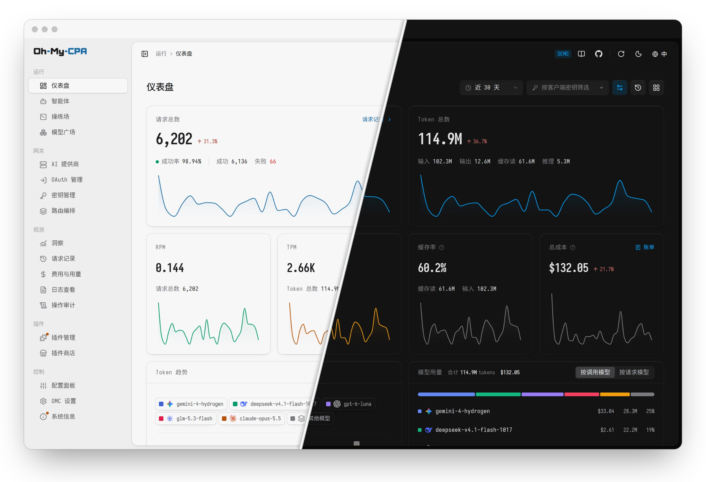
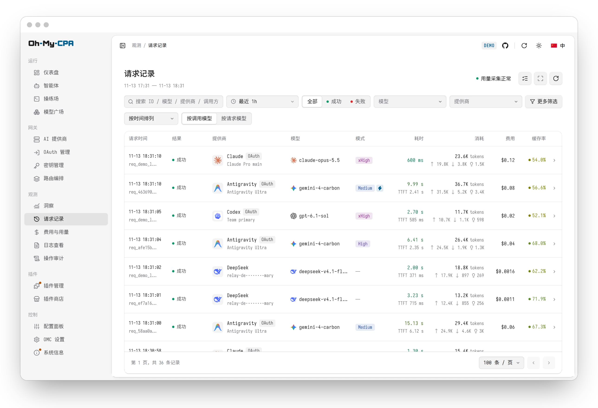
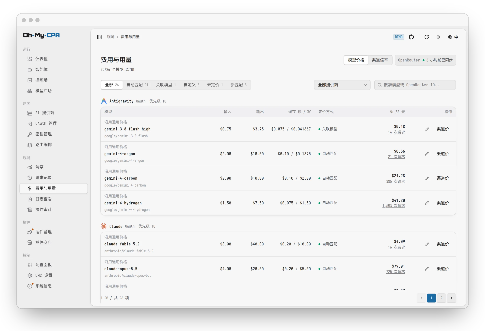
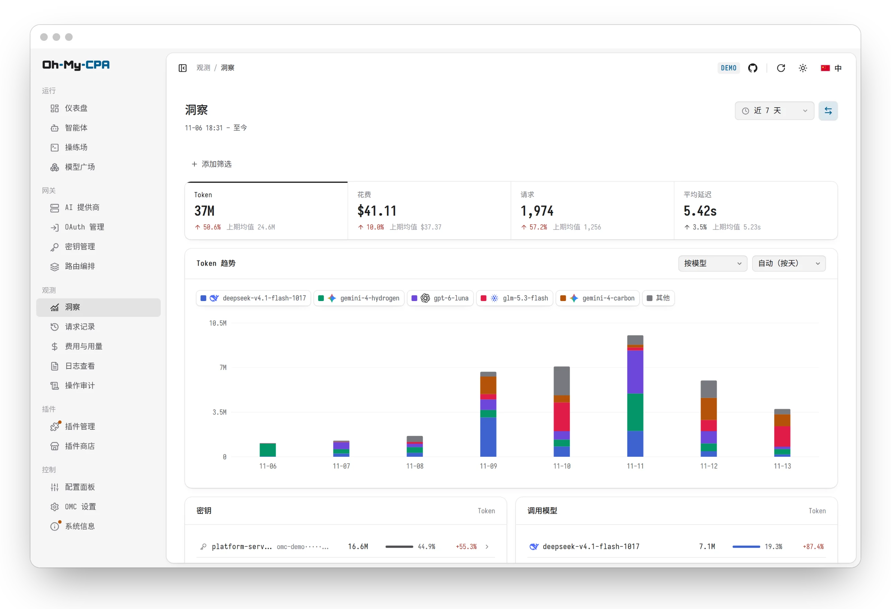
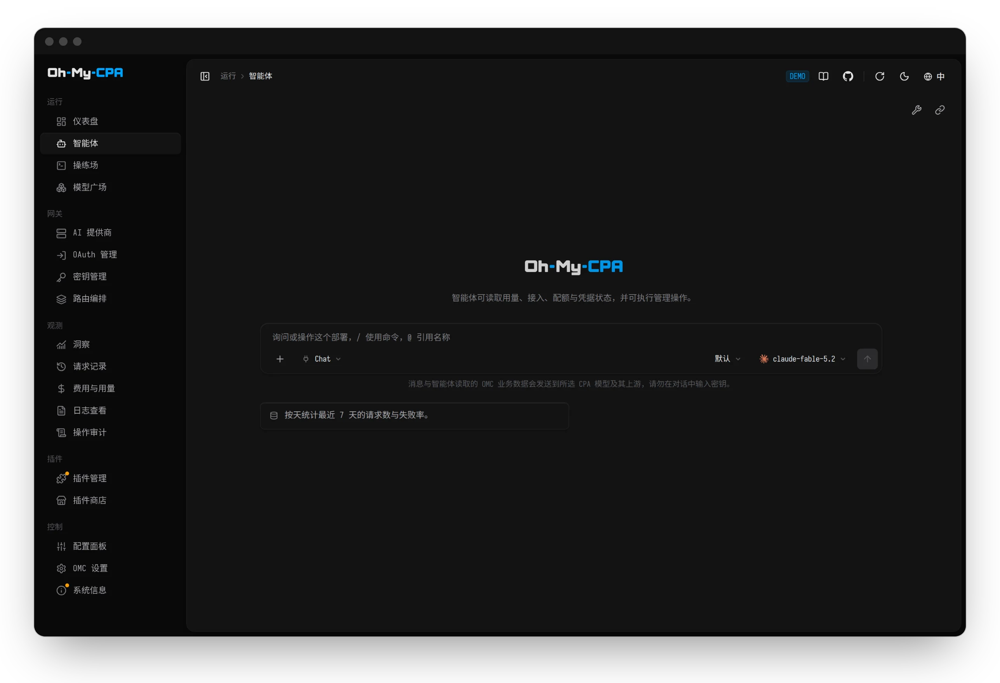
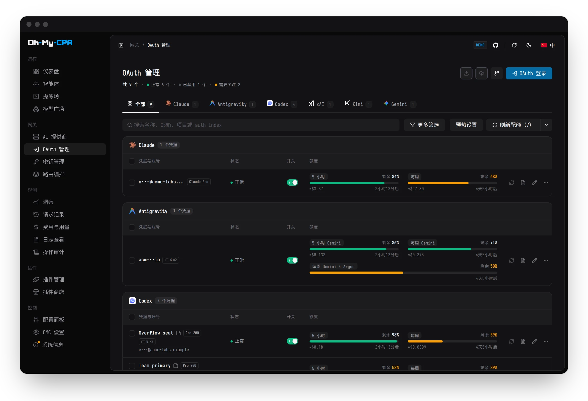
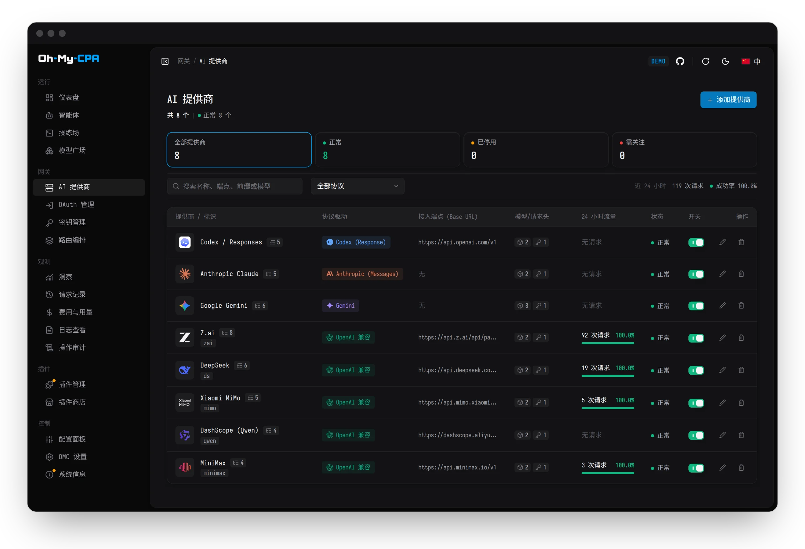
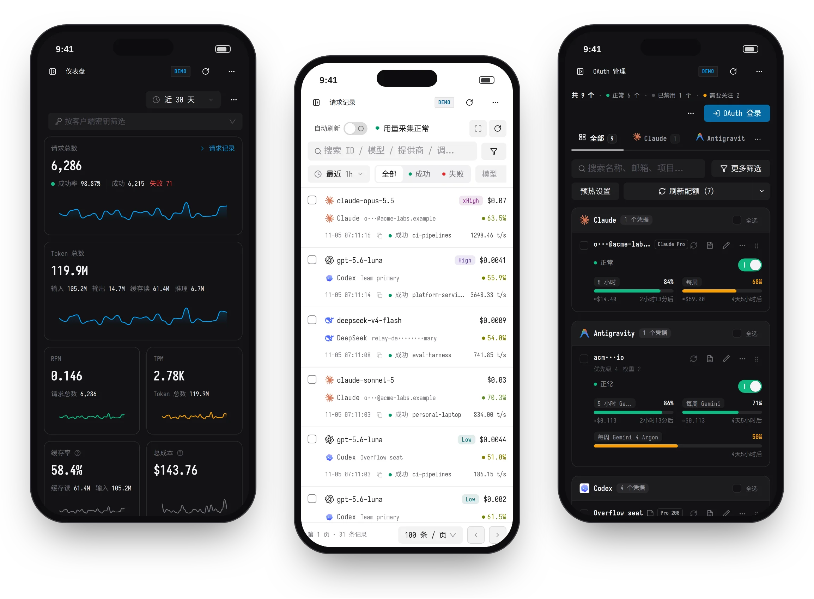

<div align="center">

<a href="#gh-light-mode-only">
  
</a>
<a href="#gh-dark-mode-only">
  
</a>

### 集中管理 API 与 OAuth，可视化观测请求、成本、用量

MCP · 可视化 · 管理

<br />

[](https://github.com/WizisCool/oh-my-cpa/releases)
[](https://github.com/WizisCool/oh-my-cpa/actions/workflows/ci.yml)
[](https://github.com/WizisCool/oh-my-cpa/stargazers)
[](https://hub.docker.com/r/wiziscool/oh-my-cpa)
[](https://github.com/router-for-me/CLIProxyAPI)
[](LICENSE)

<br />

**[Live Demo](https://omc-demo.junze.dev)** ·
[安装](#安装) ·
[功能特性](#功能特性) ·
[生态与插件](#生态与插件) ·
[文档](#文档) ·
[English](README.md)

<br />

<a href="https://omc-demo.junze.dev">
  
</a>

</div>

[CLIProxyAPI](https://github.com/router-for-me/CLIProxyAPI)（CPA）是一个 API 网关，负责协议适配、凭据管理与请求代理。
**Oh My CPA**（OMC）是配套的 Web 控制台：管理网关的提供商、凭据与配置，并记录每条请求的用量与费用。
OMC 是单个 Go 二进制文件，内嵌 React 控制台，数据存放在本地 SQLite，可离线运行，登录使用 CPA 的管理密钥。

> [!TIP]
> **[立即体验 Live Demo](https://omc-demo.junze.dev)**

## 界面截图

<table>
<tr>
<td width="50%" valign="top">

<p align="center"><b>请求记录</b><br />按模型、提供商、密钥、状态与费用筛选每一条请求</p>
</td>
<td width="50%" valign="top">

<p align="center"><b>费用与用量</b><br />自动匹配 OpenRouter 价格，也可自定义覆盖</p>
</td>
</tr>
<tr>
<td width="50%" valign="top">

<p align="center"><b>洞察</b><br />横向对比密钥、模型与提供商用量，呈现趋势与使用节律</p>
</td>
<td width="50%" valign="top">

<p align="center"><b>智能体</b><br />通过自然语言查询用量、分析请求，并安全操作控制台</p>
</td>
</tr>
<tr>
<td width="50%" valign="top">

<p align="center"><b>OAuth 管理</b><br />登录、查看配额、配置凭据，集中在一处完成</p>
</td>
<td width="50%" valign="top">

<p align="center"><b>AI 提供商</b><br />端点、模型、优先级，以及由网关执行的启停开关</p>
</td>
</tr>
</table>

<div align="center">
  
  <p><b>移动端布局</b><br />每个页面都适配窄屏</p>
</div>

## 安装

### 通过 Agent 安装

将以下内容交给 Claude Code、Codex、Cursor 或其他 Agent。Agent 会检查机器现状，选择合适的安装方式并执行：

```text
按照这份指南帮我安装 Oh My CPA：
https://raw.githubusercontent.com/WizisCool/oh-my-cpa/main/docs/install-for-agents.md
```

### 通过 Docker Compose 安装

环境要求：Docker Engine（含 Compose 插件），CLIProxyAPI v8.0.0 及以上。
命令按 Linux 或 macOS 终端编写，需要 `curl` 与 `openssl`。控制台的登录密码是 CPA 的管理密钥。

| 安装场景 | 方案 |
| --- | --- |
| 尚未部署 CPA | [全新安装](#全新安装) |
| 已经部署了 CPA | [已经安装了 CLIProxyAPI](#已经安装了-cliproxyapi) |

#### 全新安装

在新建目录中同时部署 CPA、OMC 与更新服务：

```bash
mkdir -p oh-my-cpa && cd oh-my-cpa
curl -fsSL https://github.com/WizisCool/oh-my-cpa/releases/latest/download/compose.full.yml -o compose.yml
curl -fsSL https://github.com/WizisCool/oh-my-cpa/releases/latest/download/cpa.config.example.yaml -o config.yaml
printf 'CPA_MANAGEMENT_KEY=%s\nOMCPA_MASTER_KEY=%s\n' "$(openssl rand -hex 24)" "$(openssl rand -hex 32)" > .env
chmod 600 .env
docker compose up -d
```

访问 **`http://127.0.0.1:8080/`**，以 `.env` 中 `CPA_MANAGEMENT_KEY` 的值登录。
提供商与客户端密钥在控制台中添加；客户端请求发往 CPA：`http://127.0.0.1:8317`。

#### 已经安装了 CLIProxyAPI

在已有 CPA 旁独立部署 OMC 与更新服务，不修改、不重启现有 CPA：

```bash
mkdir -p oh-my-cpa && cd oh-my-cpa
curl -fsSL https://github.com/WizisCool/oh-my-cpa/releases/latest/download/compose.omc.yml -o compose.yml
printf 'OMCPA_CPA_BASE_URL=http://host.docker.internal:8317\nOMCPA_MASTER_KEY=%s\n' "$(openssl rand -hex 32)" > .env
cat >> .env <<'EOF'
OMCPA_CPA_MANAGEMENT_KEY='<CPA 管理密钥的明文，而非 config.yaml 中的哈希>'
EOF
chmod 600 .env
```

编辑 `.env`，将 `<CPA 管理密钥的明文，而非 config.yaml 中的哈希>` 替换为实际密钥（若密钥含 `$` 请保留外层单引号，字面量 `'` 写作 `\'`），按 CPA 运行位置调整 `OMCPA_CPA_BASE_URL` 后启动：

```bash
docker compose up -d
```

| CPA 运行位置 | `.env` 配置 |
| --- | --- |
| 同一台宿主机，监听全部网卡 | `OMCPA_CPA_BASE_URL=http://host.docker.internal:8317`（上方默认值） |
| 另一个 Docker Compose 项目 | `OMCPA_CPA_BASE_URL=http://<CPA服务或容器名>:8317`，并添加 `OMCPA_NETWORK_NAME=<CPA网络名>` 与 `OMCPA_NETWORK_EXTERNAL=true`（或[并入 CPA 的编排文件](docs/install.md#add-to-the-existing-compose-file)） |
| 另一台机器 | `OMCPA_CPA_BASE_URL=https://<CPA地址>:8317`（或内网地址） |
| 同一台宿主机，仅监听 `127.0.0.1` | 使用[原生可执行文件](#安装原生可执行文件) |

访问 **`http://127.0.0.1:8080/`**，以管理密钥登录。

常见 `.env` 调整（无需改动 `compose.yml`，修改后执行 `docker compose up -d` 生效）：

| 需求 | `.env` 配置 |
| --- | --- |
| `8080` 端口被占用 | `OMCPA_BIND=127.0.0.1:18317`（只改宿主机映射端口，容器内保持 `:8080`） |
| 数据存放在 `./oh-my-cpa-data` | `OMCPA_DATA_PATH=./oh-my-cpa-data` 与 `OMCPA_USER=<宿主机 uid:gid>`（如 `1000:1000`，需先 `mkdir -p -m 700 ./oh-my-cpa-data`；请在首次启动前设置，启动后再改会切换到新空目录而不会自动迁移原数据卷，迁移见[数据库备份与恢复手册](docs/ops/sqlite-operations.md)） |
| 配置 HTTPS 反向代理 | 反代指向 `127.0.0.1:8080`（如 Caddy `reverse_proxy 127.0.0.1:8080`，前后端同端口无需拆分），并设置 `OMCPA_PUBLIC_URL=https://...` |

### 更新

编排文件中包含 `oh-my-cpa-updater` 服务时，控制台的**系统信息**页会在 Oh My CPA 或 CLIProxyAPI
有新版本时显示**立即更新**。更新程序拉取新镜像，按原有的配置、数据卷与网络重建容器；新容器未能正常启动时恢复原容器。

在该服务出现之前安装的部署，在 Docker 主机上执行一条命令即可启用，无需修改编排文件：

```bash
docker run --rm --pull always -u 0 -v /var/run/docker.sock:/var/run/docker.sock wiziscool/oh-my-cpa:latest updater install
```

该命令添加 `oh-my-cpa-updater` 容器，并同时把 Oh My CPA 升级到当前版本。`docker rm -f oh-my-cpa-updater`
可将其移除。镜像固定为版本标签时，控制台不会改动它。各种情况及手动更新方式见[升级](docs/install.md#upgrading)（英文）。

### 安装原生可执行文件

[标签发布](https://github.com/WizisCool/oh-my-cpa/releases)提供 macOS（Darwin）、Windows、
Linux 和 FreeBSD 的 amd64、arm64 可执行文件。每个压缩包内嵌控制台，并附环境变量模板；
下载后请按该发布的 `checksums.txt` 校验 SHA-256。无需 Go、Node 或 Docker，CPA 需单独安装。
配置、权限及升级步骤见[原生安装指南](docs/install.md#native-executable)。

### 注意事项

> [!IMPORTANT]
> 备份 `.env`。`OMCPA_MASTER_KEY` 是数据库的加密密钥，丢失后数据无法读取。

`oh-my-cpa-updater` 是唯一挂载 `/var/run/docker.sock` 的容器（等同于拥有该主机上 Docker 的控制权）；`oh-my-cpa` 主服务保持非 root 与只读根文件系统。关闭控制台更新需从 `compose.yml` 中删除 `oh-my-cpa-updater` 服务，并用 `docker rm -f oh-my-cpa-updater` 删除已运行的容器，之后通过 `docker compose pull && docker compose up -d` 更新。

远程访问、HTTPS、宿主目录权限、源码构建、升级与排障见[安装指南](docs/install.md)（英文）。

## 功能特性

<details open>
<summary><b>网关与提供商</b></summary>

- **AI 提供商**：Codex、Claude、Gemini、Meta Muse、xAI、Vertex AI、Gemini Interactions、DeepSeek 及 OpenAI 兼容服务，统一管理凭据、模型高级选项、运行时重试与错误规则、优先级、权重、代理，以及由网关执行的启停开关。
- **OAuth 管理**：在控制台登录 Codex、Claude、Antigravity、xAI、Kimi（kimi.com 与 kimi.ai）、Devin 与 Meta Muse，或导入 Vertex 服务账号密钥。认证文件、手动令牌刷新、模型列表、Meta 配额、xAI／Antigravity 实时套餐及凭据专属别名按凭据管理；共享模型别名与禁用规则按提供商统一配置。Codex、Claude 与已支持的 Antigravity 模型组以美元和 tokens 显示各窗口的预计剩余额度，按每次刷新观察到的额度消耗换算，新周期开始时沿用此前的估算。额度窗口重置约一分钟后会自动重新读取，并默认每 6 小时定时刷新一次，可在 OMC 设置中调整。 Codex／Claude 窗口预热支持按重置或每日时间调度、凭证独立策略，以及可选的确认后极小请求。已确认的自动策略会在发送前检查订阅额度与付费后备用量，并在请求后观察窗口是否激活。
- **客户端密钥**：创建、命名与吊销网关 API Key，名称会出现在请求记录与筛选项中。
- **模型目录**：直接从上游提供商拉取模型列表。
- **操练场**：用文本与图片调试任意已路由的模型，支持流式多轮对话与请求诊断。
- **插件**：已安装插件、内置连接 [OMC Community 软件源](https://github.com/omc-community/omc-plugins) 的插件商店、类型化配置表单，以及兼容 CPA 原生管理接口和模型目录的可信插件页面。信任边界见[运维文档](docs/operations.md#plugin-pages)。

</details>

<details>
<summary><b>用量观测</b></summary>

- **洞察**：按密钥、模型、提供商与凭据横向对比，支持今天、昨天、本周 / 上周、本月 / 上月、滚动时间窗或自定义区间，并与上一周期对比；提供各密钥的模型构成、流量流向与按小时的使用节律。
- **仪表盘**：请求量、Token 吞吐、缓存命中率与费用，支持 15 分钟到 90 天的预设窗口、安装以来的“全部”窗口或任意自定义区间；统计数据永久保留，请求记录按保留期滚动清理，并提供全年 Token 热力图。
- **实时路由**：展示最近一分钟调用了哪些模型，以及 CPA 把它们分配给了哪些凭据与提供商。每个新请求都会沿路由图流向凭据再返回，改道和冷却也会标出。面板在记录入库时即刻更新，实时连接不可用时改为短间隔轮询，仅在桌面宽度显示。
- **模型面板**：Token 趋势与用量环形图，可按调用模型或请求模型统计，并展示费用占比。
- **请求记录**：多条件筛选与全文搜索；新记录入库即实时推送显示；详情抽屉展示耗时、首字延迟、Token 明细与单请求原始日志。每条记录保留上游实际返回的模型，与请求模型不同时会被标出。
- **显示货币**：在 OMC 设置中选择 USD、人民币、令吉、日元、欧元等十一种主流货币。仪表盘、请求记录和洞察使用 Frankfurter v2 汇率换算，支持每日自动更新、手动刷新和 SQLite 缓存；记账与费用用量仍使用美元。
- **后台采集**：无论是否打开浏览器，用量都会通过流式订阅或轮询持续入库。
- **日志与审计**：实时查看网关日志与控制台自身的服务日志；操作审计记录只增不改，支持筛选与 JSON 导出。

</details>

<details>
<summary><b>定价与成本</b></summary>

- **请求时价格快照**：请求完成时通过不可变价格版本锁定费用。
- **OpenRouter 价目表**：依据 OpenRouter 公开列表为网关提供的每个模型定价，支持长上下文分档与分时段价格。
- **关联与自定义价格**：把模型关联到指定的 OpenRouter 条目，或自行设置费率，附带分档预设与试算器。
- **渠道倍率**：按提供商缩放其应答的全部请求，例如按 3 折计费的中转站。
- **渠道模型价格**：同一模型可在不同渠道设置独立费率和优惠时段，未单独设置时沿用通用价格。

</details>

<details>
<summary><b>配置与安全</b></summary>

- **双模式配置编辑**：结构化表单，或保留注释的 Monaco YAML 编辑器。
- **配置自动备份**：每次改写 `config.yaml` 之前自动保存一份加密副本，可在控制台恢复。
- **静态加密**：已存储的凭据与原始用量消息采用 AES-GCM 加密。
- **敏感操作审计**：查看密钥、下载认证文件、导出日志等操作都会写入审计日志，写入失败则拒绝执行。
- **个性化**：四种界面语言、可自定义配色的浅色与深色主题、界面与等宽字体（内置字体，或上传、从 Google Fonts 安装后由控制台自身提供的字体库）、部署时区，以及 K/M/B 或 万/亿 数字单位。

</details>

## 生态与插件

Oh My CPA 默认连接 [OMC Community](https://github.com/omc-community) 社区生态，支持一键发现、安装和更新官方提供商插件及社区扩展。

- **OMC Community 社区主页**：可在 [github.com/omc-community](https://github.com/omc-community) 浏览官方维护的提供商集成、辅助工具与社区贡献插件。
- **软件源订阅地址**：控制台开箱默认订阅 [`omc-community/omc-plugins`](https://github.com/omc-community/omc-plugins)。支持在 CPA `config.yaml` 或控制台设置中按需订阅聚合总源或拆分源：
  - **聚合总源**（默认）：`https://raw.githubusercontent.com/omc-community/omc-plugins/main/registry.json`
  - **官方维护源**：`https://raw.githubusercontent.com/omc-community/omc-plugins/main/official.json`
  - **社区贡献源**：`https://raw.githubusercontent.com/omc-community/omc-plugins/main/community.json`
- **插件贡献与开发**：插件收录规范、自动化校验与提交流程见 [omc-community/omc-plugins](https://github.com/omc-community/omc-plugins)。

## 配置

| 变量 | 默认值 | 用途 |
| --- | --- | --- |
| `OMCPA_CPA_BASE_URL` | 必填 | CPA 的地址 |
| `OMCPA_CPA_MANAGEMENT_KEY` | 必填 | CPA 管理密钥，同时是控制台登录密码 |
| `OMCPA_MASTER_KEY` | 必填 | 静态加密密钥（`openssl rand -hex 32`） |
| `OMCPA_BIND` | `127.0.0.1:8080` | Docker 宿主机映射地址 |
| `OMCPA_LISTEN_ADDR` | `:8080` | 进程监听地址（原生部署改端口时使用） |
| `OMCPA_DATA_PATH` | `oh-my-cpa-data` | Docker 数据卷名或宿主机目录路径 |
| `OMCPA_USER` | `10001:10001` | 容器运行 `uid:gid` |
| `OMCPA_DATA_DIR` | `./data` | SQLite 数据库所在目录（容器镜像内为 `/data`） |
| `OMCPA_BASE_PATH` | `/` | URL 前缀；默认在根路径提供控制台 |
| `OMCPA_PUBLIC_URL` | 未设置 | 浏览器访问的地址；为 `https://` 时会话 Cookie 带 `Secure` 标记 |
| `OMCPA_USAGE_INGEST_MODE` | `auto` | 用量采集模式，设为 `off` 时关闭用量采集 |
| `OMCPA_USAGE_RETENTION_DAYS` | `90` | 请求记录保留天数，`0` 为全部保留；可在 OMC 设置 → 数据保留中修改。仪表盘统计永久保留 |
| `OMCPA_USAGE_INBOX_RETENTION_DAYS` | `7` | 捕获载荷（供重新解码的原始上报）保留天数，`0` 为跟随请求记录 |
| `TZ` | 系统时区 | 服务器日历，需与 CPA 一致；容器内默认为 UTC |

完整的配置参考、部署约束与运维须知见 [`docs/operations.md`](docs/operations.md)。

## 架构

```text
浏览器 ──▶ 直接访问 / 已有 HTTPS 入口 ──▶ Oh My CPA (:8080)
                                           ├─ 内嵌 React SPA (/)
                                           ├─ SQLite WAL (/data)
                                           └─ 用量采集器 ──▶ CLIProxyAPI (:8317)
```

- **单二进制**：React 控制台内嵌在 Go 可执行文件中。
- **单副本**：SQLite WAL 模式，每个数据目录只允许一个进程。
- **默认根路径**：直接在 `/` 提供控制台；需要时可通过 `OMCPA_BASE_PATH` 配置子路径。
- **接口白名单**：普通控制台接口只返回经过筛选的安全字段；可信插件页面使用有边界的原生接口。仍禁止代理任意目标 URL。

模块划分、数据流与架构约束见 [`docs/architecture.md`](docs/architecture.md)。

## 文档

除本页外，技术文档均以英文撰写。

**使用**

| 文档 | 内容 |
| --- | --- |
| [`docs/install.md`](docs/install.md) | 安装、验证、升级与排障 |
| [`docs/install-for-agents.md`](docs/install-for-agents.md) | 写给编码 Agent 执行的安装指南 |
| [`docs/operations.md`](docs/operations.md) | 配置参考与运维须知 |
| [`docs/ops/sqlite-operations.md`](docs/ops/sqlite-operations.md) | 备份、恢复与主密钥管理手册 |
| [`docs/agent-capabilities.md`](docs/agent-capabilities.md) | 智能体能力清单、权限规则与 MCP 接入 |
| [`docs/cpa-v8-compat.md`](docs/cpa-v8-compat.md) | CPA v8 基线与配置字段迁移对照 |
| [`docs/pricing.md`](docs/pricing.md) | 价格表、计费分层与锁定的费用快照 |

**开发**

| 文档 | 内容 |
| --- | --- |
| [`CONTRIBUTING.md`](CONTRIBUTING.md) | 开发环境与验证流程 |
| [`docs/testing.md`](docs/testing.md) | 测试分层、本地反馈与 CI 验证 |
| [`AGENTS.md`](AGENTS.md) | 编码 Agent 在本仓库中遵循的约定 |
| [`docs/architecture.md`](docs/architecture.md) | 模块边界、数据流与架构约束 |
| [`CONTEXT.md`](CONTEXT.md) · [`docs/design.md`](docs/design.md) | 领域术语 · 视觉系统 |
| [`docs/releasing.md`](docs/releasing.md) | Docker Hub 镜像、原生压缩包与 GitHub 标签发布流程 |
| [`docs/ops/cloudflare-demo.md`](docs/ops/cloudflare-demo.md) | 在线演示的部署方式 |

## 参与贡献

欢迎提交 Issue 与 Pull Request。开发环境需要 Go 1.26+、Node.js 22+ 与 pnpm 11+：

```bash
pnpm install --frozen-lockfile
cp .env.example .env
pnpm dev          # Air + Vite 热重载，地址 http://127.0.0.1:5173/
```

推送前运行 `pnpm verify`。环境搭建与验证流程见 [`CONTRIBUTING.md`](CONTRIBUTING.md)。

## 安全

安全漏洞按 [`SECURITY.md`](SECURITY.md) 的说明私下报告，不要公开提 Issue。

## 致谢

Oh My CPA 基于 [CLIProxyAPI](https://github.com/router-for-me/CLIProxyAPI) 构建，协议适配、凭据管理与请求代理均由后者完成。

也感谢 [Linux.do 社区](https://linux.do)。

## 开源协议

[MIT](LICENSE)
